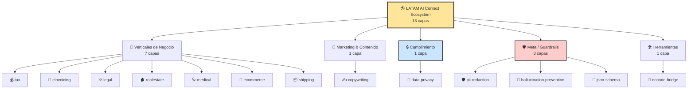

# 🌎 LATAM AI Context Ecosystem

[](https://github.com/ProcontextMax?tab=repositories)
[](LICENSE)
[]()
[]()
[](https://ko-fi.com/yellowtips)

> **ES:** El hub del ecosistema: 13 capas de contexto abiertas para que los LLMs operen con precisión en LATAM y España. Verticales de negocio, capas transversales de cumplimiento, guardrails meta y herramientas — diseñadas para combinarse entre sí.
> **EN:** The ecosystem hub: 13 open context layers so LLMs operate precisely across LATAM and Spain. Business verticals, cross-cutting compliance layers, meta guardrails and tools — designed to be combined with each other.

> 📄 **Versión del hub:** 1.0.0 · **Capas indexadas:** 13 · **Ámbito:** México, Colombia, Argentina, Chile, Perú y España · **Uso:** Punto de entrada al ecosistema; cada capa se inyecta por separado.

> 🇪🇸 [Español](#-español) · 🇬🇧 [English](#-english)

---

## 🇪🇸 Español

### 🎯 ¿Qué es este repositorio?

Este no es una capa más. Es **el índice y mapa** de todo el ecosistema de 13 capas de contexto que mantengo en `ProcontextMax`.

Cada capa es un archivo JSON con reglas, plazos legales, perfiles por país y fallbacks que se inyecta como `system prompt` en un LLM para que responda con precisión de dominio. Por sí sola, cada capa resuelve un problema. **Combinadas, resuelven flujos completos**.

Aquí encontrarás:

- El **mapa completo** del ecosistema, categorizado.
- **Recetas de stacking** probadas para casos de uso reales (ecommerce, legal, médico, etc.).
- **Puntos de entrada por perfil**: freelancer, dev, DPO, agencia.
- El **código de combinación** para usar varias capas en el mismo agente.

> 💡 **Empieza por aquí si es tu primera vez.** Elige tu caso de uso en la tabla de abajo, y te lleva directo a la combinación de capas que necesitas.

---

### 🗺️ Mapa del ecosistema



---

### 📚 Catálogo completo

#### 🎯 Verticales de Negocio (7)

| Capa | Qué resuelve | Repo |
| :--- | :--- | :--- |
| 💰 **tax** | Fiscalidad freelance: cobros internacionales, retenciones, regímenes por país | [latam-freelance-tax-context-ai](https://github.com/ProcontextMax/latam-freelance-tax-context-ai) |
| 🧾 **einvoicing** | Facturación electrónica: CFDI 4.0, DIAN, ARCA, SII, SUNAT, Veri*factu | [latam-einvoicing-context-ai](https://github.com/ProcontextMax/latam-einvoicing-context-ai) |
| ⚖️ **legal** | Contratos, NDA, cesión de PI, Civil Law vs. Common Law | [latam-legal-agreements-ai](https://github.com/ProcontextMax/latam-legal-agreements-ai) |
| 🏠 **realestate** | Fichas inmobiliarias, arriendos, comisiones, impuestos de transferencia | [latam-realestate-proptech-ai](https://github.com/ProcontextMax/latam-realestate-proptech-ai) |
| 🩺 **medical** | Notas SOAP, consentimiento informado, terminología clínica | [latam-ai-medical-clinic-context](https://github.com/ProcontextMax/latam-ai-medical-clinic-context) |
| 🛒 **ecommerce** | Soporte al cliente, retracto, garantías, escalación con tiers | [latam-ecommerce-customer-service-ai](https://github.com/ProcontextMax/latam-ecommerce-customer-service-ai) |
| 📦 **shipping** | Aduanas, minimis, Incoterms, couriers, documentación | [latam-shipping-customs-context-ai](https://github.com/ProcontextMax/latam-shipping-customs-context-ai) |

#### 📣 Marketing & Contenido (1)

| Capa | Qué resuelve | Repo |
| :--- | :--- | :--- |
| ✍️ **copywriting** | AIDA, PAS, 4Ps, BAB, FAB, StoryBrand; tono regional; anti-cliché | [latam-copywriting-frameworks-ai](https://github.com/ProcontextMax/latam-copywriting-frameworks-ai) |

#### 🔒 Cumplimiento (1)

| Capa | Qué resuelve | Repo |
| :--- | :--- | :--- |
| 🔐 **data-privacy** | LFPDPPP 2025, Ley 1581, Ley 25.326, Ley 19.628, Ley 29733, GDPR/LOPDGDD; ARCO; neurodatos | [latam-data-privacy-context-ai](https://github.com/ProcontextMax/latam-data-privacy-context-ai) |

#### 🛡️ Meta / Guardrails (3)

| Capa | Qué resuelve | Repo |
| :--- | :--- | :--- |
| 🛡️ **pii-redaction** | Anonimizar PII antes de procesar: RFC, CURP, CUIT, RUT, NIT, DNI, NIE, IBAN | [latam-ai-pii-redaction](https://github.com/ProcontextMax/latam-ai-pii-redaction) |
| 🧠 **hallucination-prevention** | Abstención calibrada, citación, grounding, señales de alucinación | [latam-ai-hallucination-prevention](https://github.com/ProcontextMax/latam-ai-hallucination-prevention) |
| 🧱 **json-schema** | Output estricto en JSON (RFC 8259), envelope `status/data/error`, códigos E001–E008 | [latam-ai-agents-json-schema](https://github.com/ProcontextMax/latam-ai-agents-json-schema) |

#### 🛠️ Herramientas (1)

| Capa | Qué resuelve | Repo |
| :--- | :--- | :--- |
| 🧩 **nocode-bridge** | Traducir código tradicional a arquitectura No-Code: Bubble, FlutterFlow, Make, n8n, Supabase, Xano | [latam-nocode-ai-bridge](https://github.com/ProcontextMax/latam-nocode-ai-bridge) |

---

### 🧭 Encuentra tu capa por caso de uso

| Si necesitas… | Empieza por… | Combínala con… |
| :--- | :--- | :--- |
| Gestionar cobros y retenciones de un freelance | 💰 tax | 🔐 data-privacy |
| Emitir/cancelar facturas electrónicas | 🧾 einvoicing | 🛡️ pii-redaction |
| Redactar un NDA o contrato de servicios | ⚖️ legal | 🛡️ pii-redaction + 🧠 hallucination-prevention |
| Publicar una ficha inmobiliaria que convierta | 🏠 realestate | ✍️ copywriting |
| Estructurar una nota clínica sin violar privacidad | 🩺 medical | 🛡️ pii-redaction + 🔐 data-privacy |
| Configurar un chatbot de soporte ecommerce | 🛒 ecommerce | 🧾 einvoicing + 🛡️ pii-redaction |
| Calcular impuestos de importación | 📦 shipping | 🧾 einvoicing |
| Escribir copy que venda sin sonar a plantilla | ✍️ copywriting | 🧠 hallucination-prevention |
| Responder consultas de GDPR / LFPDPPP | 🔐 data-privacy | 🧠 hallucination-prevention |
| Construir un agente que devuelva JSON puro | 🧱 json-schema | 🧠 hallucination-prevention |
| Traducir un requerimiento a Bubble/FlutterFlow | 🧩 nocode-bridge | 🧱 json-schema |

---

### 🧩 Recetas de stacking

Combinaciones probadas de 2–3 capas para casos de uso completos.

#### Receta 1 — Chatbot de ecommerce completo

```python
layers = [
    "latam-ai-pii-redaction.json",           # 1. Redactar PII primero
    "latam-ecommerce-support.json",          # 2. Aplicar protocolo de soporte
    "latam-einvoicing-context.json"          # 3. Explicar CFDI/DIAN/SII si aplica
]

combined = {"layers": [json.load(open(f)) for f in layers]}

response = client.chat.completions.create(
    model="gpt-4o",
    messages=[
        {"role": "system", "content": json.dumps(combined)},
        {"role": "user", "content": user_message}
    ]
)
```

**Por qué funciona:** PII se enmascara antes de llegar al modelo (input seguro), el protocolo de ecommerce aplica plazos de retracto por país (proceso correcto), y einvoicing permite explicar facturación sin invadir el flujo de soporte.

---

#### Receta 2 — Asistente legal seguro

```python
layers = [
    "latam-ai-pii-redaction.json",
    "latam-legal-agreements.json",
    "latam-ai-hallucination-prevention.json"
]
```

**Por qué funciona:** redacta nombres y documentos antes de procesar, aplica Civil Law hispano (no Common Law), y se abstiene cuando el caso exige interpretación normativa que la capa no cubre.

---

#### Receta 3 — Agente médico compliant

```python
layers = [
    "latam-ai-pii-redaction.json",
    "latam-ai-medical-clinic-context.json",
    "latam-data-privacy-context-ai.json"
]
```

**Por qué funciona:** enmascara PII antes de procesar, estructura en SOAP con anonimización obligatoria, y aplica la normativa local (LFPDPPP, Ley 1581, GDPR) al responder sobre consentimiento y tratamiento.

---

#### Receta 4 — Copy que no alucina

```python
layers = [
    "latam-copywriting-frameworks.json",
    "latam-ai-hallucination-prevention.json"
]
```

**Por qué funciona:** el copy aplica el marco correcto (AIDA, PAS, etc.), pero se abstiene de inventar cifras, testimonios o casos de éxito que no están respaldados.

---

#### Receta 5 — Pipeline de automatización puro (sin conversación)

```python
layers = [
    "latam-ai-agents-json-schema.json",
    "latam-ai-hallucination-prevention.json"
]
```

**Por qué funciona:** fuerza output en JSON puro (sin texto conversacional) y garantiza que los campos no se inventen si faltan datos (`E001` missing_field en lugar de un valor fabricado).

---

#### Receta 6 — Freelancer fiscal todo-en-uno

```python
layers = [
    "latam-ai-pii-redaction.json",
    "latam-freelance-tax-context.json",
    "latam-einvoicing-context.json"
]
```

**Por qué funciona:** redacta datos personales del cliente, aplica reglas de cobro internacional y retenciones, y permite explicar facturación electrónica del país.

---

#### Receta 7 — De idea a producto No-Code

```python
layers = [
    "latam-nocode-ai-bridge.json",
    "latam-ai-agents-json-schema.json"
]
```

**Por qué funciona:** traduce la lógica a componentes visuales (Bubble, FlutterFlow, Make) y devuelve la especificación en JSON estructurado para copiar directo a la plataforma.

---

#### Reglas de oro del stacking

| Regla | Por qué |
| :--- | :--- |
| **PII redaction va primero** | Debe enmascarar antes de cualquier otra tarea |
| **JSON schema va al final** | Su contrato de output envuelve a las demás capas |
| **Máximo 3 capas por agente** | Más de 3 satura el contexto y el modelo ignora reglas |
| **No apilar capas que choquen en tono** | Ej: médica (formal) + copywriting (informal) se contradicen |
| **Guardrails en todas las capas sensibles** | Cualquier capa que toque PII debe combinarse con `pii-redaction` |

---

### 🚀 Empieza en 5 minutos

Elige tu perfil y sigue la ruta.

#### 👤 Freelancer

```
1. Abre ChatGPT o Claude
2. Pega el JSON de la capa que necesitas (ej. tax, einvoicing)
3. Añade al final: "Confirma que entendiste y espera mi consulta"
4. Pregunta lo que necesites
```

Empieza por: 💰 [tax](https://github.com/ProcontextMax/latam-freelance-tax-context-ai) · 🧾 [einvoicing](https://github.com/ProcontextMax/latam-einvoicing-context-ai)

#### 💻 Dev / Founder

```python
# 1. Descarga los JSON
# 2. Cárgalos en tu backend
# 3. Inyéctalos como system prompt
# 4. Combina 2-3 según tu caso de uso

import json
from openai import OpenAI

with open("latam-ai-pii-redaction.json") as f:
    pii = json.load(f)
with open("latam-ecommerce-support.json") as f:
    support = json.load(f)

combined = {"layers": [pii, support]}

response = client.chat.completions.create(
    model="gpt-4o",
    messages=[
        {"role": "system", "content": json.dumps(combined)},
        {"role": "user", "content": user_message}
    ]
)
```

Empieza por: 🛡️ [pii-redaction](https://github.com/ProcontextMax/latam-ai-pii-redaction) · 🧠 [hallucination-prevention](https://github.com/ProcontextMax/latam-ai-hallucination-prevention)

#### 🏢 Agencia

```
1. Crea un GPT personalizado en ChatGPT (o Project en Claude)
2. Instructions: pega el JSON de la capa principal
3. Conversation starters: añade 3-4 ejemplos de consultas
4. Comparte con tu equipo en "Anyone with the link"
5. Cada agente lo usa desde el menú sin reconfigurar nada
```

Empieza por: 🛒 [ecommerce](https://github.com/ProcontextMax/latam-ecommerce-customer-service-ai) · ✍️ [copywriting](https://github.com/ProcontextMax/latam-copywriting-frameworks-ai)

#### 🔒 DPO / Compliance

```
1. Despliega pii-redaction como capa base obligatoria en TODOS los agentes
2. Añade hallucination-prevention en agentes de cara al cliente
3. Añade data-privacy en agentes que respondan sobre GDPR/LFPDPPP
4. Audita logs: cualquier respuesta sin bloque de confianza es una alerta
```

Empieza por: 🛡️ [pii-redaction](https://github.com/ProcontextMax/latam-ai-pii-redaction) · 🔐 [data-privacy](https://github.com/ProcontextMax/latam-data-privacy-context-ai)

---

### 🏗️ Arquitectura de capas

Los 13 repos no son proyectos aislados. Forman **un sistema** con tres niveles:

```
┌─────────────────────────────────────────────────────────────┐
│                    TUS AGENTES / APPS                       │
└─────────────────────────┬───────────────────────────────────┘
                          │
┌─────────────────────────┴───────────────────────────────────┐
│         CAPAS META / GUARDRAILS (transversales)             │
│    🛡️ pii-redaction · 🧠 hallucination · 🧱 json-schema    │
└─────────────────────────┬───────────────────────────────────┘
                          │
┌─────────────────────────┴───────────────────────────────────┐
│         CAPAS VERTICALES (por dominio de negocio)           │
│  💰 tax · 🧾 einvoicing · ⚖️ legal · 🏠 realestate         │
│  🩺 medical · 🛒 ecommerce · 📦 shipping · ✍️ copywriting  │
│                  🔐 data-privacy                            │
└─────────────────────────┬───────────────────────────────────┘
                          │
┌─────────────────────────┴───────────────────────────────────┐
│                 DATOS DEL NEGOCIO                           │
│    Pedidos · Clientes · Contratos · Facturas · Notas        │
└─────────────────────────────────────────────────────────────┘
```

**Cómo leerlo:**

- Las **capas verticales** resuelven dominios específicos (qué sabe el modelo).
- Las **capas meta** protegen y estructuran (cómo se comporta el modelo).
- Se combinan **vertical + meta**, nunca meta sola (la meta no tiene conocimiento de dominio).

---

### 📊 Estado de las capas

| Capa | Versión | Estado | Última actualización | Bilingüe |
| :--- | :---: | :---: | :---: | :---: |
| 💰 tax | 1.0.0 | ✅ estable | 2026-10-21 | ✅ |
| 🧾 einvoicing | 1.0.0 | ✅ estable | 2026-10-21 | ✅ |
| ⚖️ legal | 1.0.0 | ✅ estable | 2026-10-21 | ✅ |
| 🏠 realestate | 1.0.0 | ✅ estable | 2026-10-21 | ✅ |
| 🩺 medical | 1.0.0 | ✅ estable | 2026-10-21 | ✅ |
| 🛒 ecommerce | 1.0.0 | ✅ estable | 2026-10-21 | ✅ |
| 📦 shipping | 1.0.0 | ✅ estable | 2026-10-21 | ✅ |
| ✍️ copywriting | 1.0.0 | ✅ estable | 2026-10-21 | ✅ |
| 🔐 data-privacy | 1.0.0 | ✅ estable | 2026-10-21 | ✅ |
| 🛡️ pii-redaction | 1.0.0 | ✅ estable | 2026-10-21 | ✅ |
| 🧠 hallucination-prevention | 1.0.0 | ✅ estable | 2026-10-21 | ✅ |
| 🧱 json-schema | 1.0.0 | ✅ estable | 2026-10-21 | ✅ |
| 🧩 nocode-bridge | 1.0.0 | ✅ estable | 2026-10-21 | ✅ |

---

### 🤖 Compatibilidad

Todas las capas del ecosistema funcionan con las mismas plataformas.

| Plataforma | Método de inyección | Soporte |
| :--- | :--- | :---: |
| OpenAI GPT-4o / o1 | `system` prompt vía API | ✅ |
| OpenAI GPTs personalizados | Campo *Instructions* | ✅ |
| Anthropic Claude 3.5+ | `system` block | ✅ |
| Google Gemini 1.5+ | `systemInstruction` | ✅ |
| Llama 3 / Mistral (local) | Prompt template | ✅ |
| ChatGPT / Claude Web | Copy-paste | ✅ |
| n8n / Make / Zapier | System message + Parse JSON | ✅ |
| Cursor / Windsurf | Archivo `.context/` | ✅ |

---

### 🤝 Contribuir

Este ecosistema crece con aportes de la comunidad. Maneras de contribuir:

| Tipo de contribución | Cómo |
| :--- | :--- |
| **Nueva capa** de dominio | Abre issue con propuesta y luego PR con el nuevo repo |
| **Actualizar plazos legales** | PR al repo correspondiente con la reforma y su fuente |
| **Añadir país** a una capa existente | PR con nuevo `country_profiles` + ejemplos |
| **Corregir errores** | Issue con el error + fuente que lo respalda |
| **Compartir caso de uso** | Discussion con tu combinación probada |

Cada repo tiene su propio `README.md` con instrucciones detalladas de contribución.

---

### ☕ Apoya este ecosistema

Mantengo los 13 repositorios en mi tiempo libre para que freelancers, devs y equipos puedan construir agentes de IA con precisión en español. Si esta colección te ahorró horas de research o te ayudó a construir algo, puedes invitarme un café:

👉 **[ko-fi.com/yellowtips](https://ko-fi.com/yellowtips)**

Cada aporte mantiene las capas actualizadas con cambios normativos que llegan cada trimestre en LATAM y España.

---

### 📄 Licencia

**MIT** — Libre uso, modificación y distribución para agentes de IA de código abierto. Ver [`LICENSE`](LICENSE). Cada repo individual tiene su propio archivo `LICENSE` con los mismos términos.

> Este hub es un **índice**. Las capas individuales tienen sus propios disclaimers y advertencias de uso. Consulta cada README antes de implementar. El autor no se responsabiliza por decisiones tomadas a partir de estas capas.

---

## 🇬🇧 English

### 🎯 What is this repository?

This isn't another layer. It's the **index and map** of the whole ecosystem of 13 context layers maintained under `ProcontextMax`.

Each layer is a JSON file with rules, legal deadlines, per-country profiles and fallbacks, injected as a `system prompt` into an LLM so it responds with domain precision. On its own, each layer solves one problem. **Combined, they solve full workflows**.

Here you'll find:

- The **complete map** of the ecosystem, categorized.
- **Stacking recipes** tested for real use cases (ecommerce, legal, medical, etc.).
- **Entry points by persona**: freelancer, dev, DPO, agency.
- The **combination code** to use multiple layers in the same agent.

> 💡 **Start here if it's your first time.** Pick your use case in the table below, and it takes you directly to the layer combination you need.

---

### 🗺️ Ecosystem map

Same Mermaid diagram as the Spanish section above — copy from there.

---

### 📚 Full catalog

Same tables as the Spanish section above — copy from there.

---

### 🧭 Find your layer by use case

Same table as the Spanish section above — copy from there.

---

### 🧩 Stacking recipes

Same code snippets as the Spanish section above — copy from there.

#### Golden rules of stacking

Same rules as the Spanish section above — copy from there.

---

### 🚀 Get started in 5 minutes

Same persona-based quick starts as the Spanish section above — copy from there.

---

### 🏗️ Layer architecture

Same ASCII diagram as the Spanish section above — copy from there.

---

### 📊 Layer status

Same table as the Spanish section above — copy from there.

---

### 🤖 Compatibility

Same table as the Spanish section above — copy from there.

---

### 🤝 Contributing

This ecosystem grows with community contributions. Ways to contribute:

| Contribution type | How |
| :--- | :--- |
| **New domain layer** | Open issue with proposal, then PR with the new repo |
| **Update legal deadlines** | PR to the corresponding repo with the reform and its source |
| **Add country** to an existing layer | PR with new `country_profiles` + examples |
| **Fix errors** | Issue with the error + supporting source |
| **Share use case** | Discussion with your tested combination |

Each repo has its own `README.md` with detailed contribution instructions.

---

### ☕ Support this ecosystem

I maintain the 13 repositories in my free time so freelancers, devs and teams can build AI agents with precision in Spanish. If this collection saved you hours of research, you can buy me a coffee:

👉 **[ko-fi.com/yellowtips](https://ko-fi.com/yellowtips)**

---

### 📄 License

**MIT** — Free use, modification and distribution for open-source AI agents. See [`LICENSE`](LICENSE). Each individual repo has its own `LICENSE` file with the same terms.

> This hub is an **index**. Individual layers have their own disclaimers and usage warnings. Check each README before implementing. The author is not liable for decisions made based on these layers.

---

<p align="center">
  <sub>Built with 🟡 by <a href="https://ko-fi.com/yellowtips">Yellow Tips</a> · If this helped you, ⭐ the repo and share it.</sub>
</p>
